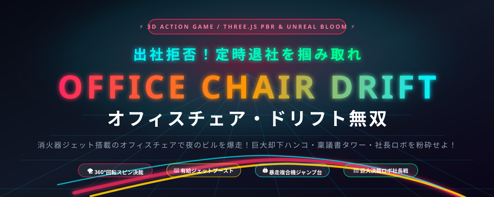

<p align="center">
  
</p>

<h1 align="center">出社拒否！オフィスチェア・ドリフト無双</h1>
<p align="center"><b>Office Chair Drift: The Overtime Obliteration</b></p>

<p align="center">
  <a href="LICENSE"></a>
  <a href="https://threejs.org/" target="_blank" rel="noopener noreferrer"></a>
  <a href="https://developer.mozilla.org/ja/docs/Web/API/WebGL_API" target="_blank" rel="noopener noreferrer"></a>
  <a href="https://developer.mozilla.org/ja/docs/Web/API/Web_Audio_API" target="_blank" rel="noopener noreferrer"></a>
  <a href="package.json"></a>
  <a href="https://github.com/harukaappscreate/office-chair-drift/pulls"></a>
</p>

<p align="center">
  <b>消火器ジェットを改造装着したオフィスチェアで夜のオフィスを爆走！</b><br>
  迫りくる<b>「巨大却下ハンコ」「暴走稟議書タワー」「巨大決裁ロボ社長」</b>を<br>
  <b>回転ドリフト・複合機大ジャンプ・有給ブースト</b>で粉砕し、定時退社を勝ち取れ！
</p>

<p align="center">
  <a href="#-ゲームの特徴">ゲームの特徴</a> •
  <a href="#-操作方法">操作方法</a> •
  <a href="#-ゲームシステム">ゲームシステム</a> •
  <a href="#-ローカルで動かす方法">ローカル実行</a> •
  <a href="#-ディレクトリ構成">ディレクトリ構成</a> •
  <a href="#-english-readme">English</a>
</p>

---

## ⚡ ゲームの特徴

- 🏎️ **超爽快オフィスチェアドリフト**: 左右移動でタイヤ痕（ブラックマーク）を残し、横Gでカメラがダイナミックにバンク！
- 🌪️ **360°回転スピン決裁**: Wキー / 左クリックで大回転スピン！ハンコを「承認!!」爆破し、ボス戦ではハンコを跳ね返すパリィ攻撃に！
- 🖨️ **暴走複合機ジャンプ台（エアリアル跳躍）**: 緑に光る大型複合機に乗るとビル内を大ジャンプ！空中からハンコや部長を一網打尽！
- 🤖 **巨大決裁ロボ社長「ブラック・カイザー」**: 定時退社ゲート前に立ちふさがる巨大ボス！ハンコ弾幕を回転スピンで跳ね返して論破せよ！
- 🎵 **Web Audio API プロシージャル・シンセユーロビート**: 外部音声ファイル一切不要！ブラウザのシンセ音源でBGMをリアルタイム自動演奏。ドリフト横Gに応じた連続タイヤスキール音「キュルルル！」も完全再現。
- 💥 **社畜ラグドール大クラッシュ**: メンタル(HP)が尽きると、社員が椅子から分離してスローモーションで吹っ飛ぶ物理クラッシュ演出！
- 🎨 **最新Three.js PBR ＆ UnrealBloom発光**: タイルカーペット、漆塗りハンコ、夜景の透けるブラインド窓、光るネオンHUDなどの高品質グラフィックス。
- 🚀 **ビルド不要・依存関係ゼロ**: npm install不要！ブラウザで開くだけで60fps超の滑らかな動作を実現。スマホ・タブレットのタッチ操作にも完全対応。

---

## 🕹️ 操作方法

PC（キーボード & マウス）とスマートフォン/タブレット（タッチ操作）の双方に対応しています。

| アクション | PCキーボード | マウス | モバイル / タッチ |
| :--- | :--- | :--- | :--- |
| **左右ドリフト** | `A` / `D` または `←` / `→` | マウスを左右に移動 | 画面を左右にスワイプ |
| **回転スピン決裁** | `W` または `↑` | 左クリック | 画面下部「🌪️ 回転スピン」ボタン |
| **有給ジェット発動** | `SPACE` キー | 右クリック | 画面下部「🚀 有給ブースト」ボタン |
| **複合機ジャンプ台** | 接触するだけで自動発動 | 接触するだけで自動発動 | 接触するだけで自動発動 |
| **BGMのミュート切替** | — | — | 画面下部「🔊 BGM ON/OFF」ボタン |

---

## 🏢 ゲームシステム

### 1. 障害物とギミック

| 障害物 / ギミック | 外見 | 効果・特徴 |
| :--- | :--- | :--- |
| **巨大却下ハンコ** | 朱肉印面・漆塗り木目 | 直撃するとダメージ！回転スピンで粉砕（「承認!!」）可能。ボス戦では跳ね返して社長にダメージ！ |
| **暴走稟議書タワー** | 紙の山＆キングファイル | ぶつかると大量のA4用紙がひらひらと舞い散る！スピンでシュレッダー粉砕！ |
| **残業レーザー部長** | 革張り重役椅子＆赤レーザー | 前方に残業強制レーザーを照射！有給ブースト体当たりまたはジャンプで突破！ |
| **黄金の有給休暇届** | 黄金に輝く書類アイテム | 取得するとメンタル(HP)回復 ＋ 有給ジェットゲージ大幅チャージ！ |
| **暴走複合機ジャンプ台** | 緑色スキャナー発光の複合機 | 踏み込むと大ジャンプ！空中を飛び越えて障害物をスルー＆空中スピンが可能！ |
| **巨大決裁ロボ社長** | ゲート前に出現する巨大ロボ | 漆黒のスーツと金時計を身に纏うボス。跳ね返しスピンやジャンプ体当たりで論破せよ！ |

### 2. 有給ジェットブースト
障害物を粉砕したり、黄金の有給休暇届を拾うとゲージが蓄積。ゲージ満タンで発動すると、最高速度98km/h超へ加速！無敵状態で全障害物を弾き飛ばします。

### 3. 定時退社ゲート & 称号システム
450mごとに「定時退社ゲート」が出現。ゲートを突破するごとにフロアが「第1営業部」→「経理・監査」→「システム開発室」→「重役ペントハウス」→「成層圏本社屋上」へと進化！  
ゲーム終了時には、粉砕した残業時間に応じて「見習いキャスター社員」から「伝説の定時退社ゴッド」までの退社称号が授与され、ワンクリックでSNSに結果をコピーできます。

---

## 🚀 ローカルで動かす方法

外部ビルドツール（Webpack, Vite等）のインストールは不要です。静的Webサーバーを起動するだけで動作します。

### 方法1: Node.js (推奨)

```bash
# リポジトリのクローン
git clone https://github.com/harukaappscreate/office-chair-drift.git
cd office-chair-drift

# サーバー起動 (3000番ポート)
npm start
# または
npx serve -l 3000 .
```

ブラウザで `http://localhost:3000` を開きます。

### 方法2: Python

```bash
# Python 3
python3 -m http.server 3000
```

### 方法3: VS Code (Live Server拡張機能)

VS Codeで本フォルダを開き、`index.html` を右クリックして **「Open with Live Server」** を選択します。

---

## 🌐 GitHub Pages への公開方法

本リポジトリには `.github/workflows/deploy.yml`（GitHub Actions 自動デプロイ設定）が標準搭載されています。

1. 本リポジトリをご自身の GitHub アカウントに Push します。
2. GitHub リポジトリの **Settings** > **Pages** を開きます。
3. **Build and deployment** の Source で **「GitHub Actions」** を選択します。
4. 数十秒で自動デプロイが完了し、公開URL（`https://harukaappscreate.github.io/office-chair-drift/`）で即座に全世界へゲームが配信されます！

---

## 📁 ディレクトリ構成

```text
office-chair-drift/
├── index.html                   # ゲームエントリーポイント・メタデータ・Post-Processing
├── favicon.svg                  # ベクターファビコン
├── package.json                 # プロジェクト情報・起動スクリプト
├── LICENSE                      # MIT ライセンス
├── README.md                    # 本ドキュメント
├── CONTRIBUTING.md              # コントリビューションガイド
├── .gitignore                   # Git除外設定
├── .github/
│   ├── workflows/
│   │   └── deploy.yml           # GitHub Pages 自動デプロイワークフロー
│   └── ISSUE_TEMPLATE/
│       ├── bug_report.md        # バグ報告テンプレート
│       └── feature_request.md   # 機能提案テンプレート
├── assets/
│   ├── banner.svg               # プロジェクトヘッダーバナー
│   └── favicon.svg              # アセット用アイコン
├── css/
│   └── style.css                # HUD、集中線、ポップアップ、ダークサイバーUI
└── js/
    ├── config.js                # ゲームバランス・称号・パラメータ設定
    ├── main.js                  # メインループ、入力受付、シーン統合
    ├── core/
    │   └── SceneManager.js      # Three.js PBRレンダラー、UnrealBloom、カメラバンク
    ├── entities/
    │   ├── Player.js            # オフィスチェア、多関節社員、消火器、ラグドール物理
    │   ├── Environment.js       # 夜景オフィスビル、カーペット、窓、定時退社ゲート
    │   └── ObstacleManager.js   # 巨大ハンコ、稟議書、複合機ジャンプ台、社長ロボボス
    └── systems/
        ├── GameState.js         # スコア、HP、コンボ、自己ベスト(localStorage)
        ├── SoundSystem.js       # Web Audio API ユーロビート演奏＆タイヤスキール音
        └── EffectSystem.js      # 稟議書ひらひら用紙、火花、タイヤ痕、文字ポップアップ
```

---

## 🛠️ 技術スタック

- **3D Graphics Engine**: [Three.js](https://threejs.org/) (ES Modules via Import Maps)
- **Post-Processing**: `EffectComposer`, `RenderPass`, `UnrealBloomPass`, `OutputPass`
- **Shading & Lighting**: Physically Based Rendering (PBR), ACESFilmicToneMapping, PCFSoftShadowMap, Procedural PMREM
- **Audio Engine**: Web Audio API (リアルタイムオシレーター・プロシージャル・ユーロビートシーケンサー & FM変調タイヤ摩擦音)
- **Physics & Ragdoll**: カスタム軽量ベイクド物理演算、5関節多重バネネクタイ物理、吹っ飛びラグドール演算
- **Typography & UI**: Vanilla CSS3, SVG, Glassmorphism, 集中線アニメーション

---

## 📄 License

本プロジェクトは [MIT License](LICENSE) の下で公開されています。商用・非商用問わず自由にフォーク・改変いただけます。

---

<div id="-english-readme"></div>

## 🌐 English Overview

### Office Chair Drift: The Overtime Obliteration

A high-octane, chaotic 3D office action game built with **Three.js** and the **Web Audio API**.  
Ride an ergonomic office chair retrofitted with a CO2 fire extinguisher booster to race through an endless corporate hallway, smash giant rejection stamps, jump over rampant photocopiers, parry boss attacks, and breach the Quitting-Time Gate!

### Key Features
- **High-Velocity Drift Physics**: Realistic tire skid marks, camera banking, and lateral G-force sound effects.
- **360° Spin Stamp Approval**: Spin to obliterate towering memos and parry giant stamps back at the CEO Boss!
- **Photocopier Aerial Jump Ramp**: Launch high into the air from glowing copiers to bypass congested corridors.
- **Giant Approval Robot CEO Boss**: Defeat the towering boss blocking your exit before you reach each floor gate.
- **Procedural Eurobeat Synth**: 100% procedural Web Audio synthesizer music and screeching tires without external audio files.
- **Employee Ragdoll Collision**: Hilarious slow-motion ragdoll physics when your mental health gauge runs out.
- **Zero Build, Zero Dependency**: Pure Vanilla JavaScript with modern ES Module import maps.

### Quick Start
```bash
git clone https://github.com/harukaappscreate/office-chair-drift.git
cd office-chair-drift
npx serve -l 3000 .
```
Open `http://localhost:3000` in your web browser.

---

<p align="center">
  Made with 🔥 and determination to leave the office on time.
</p>
